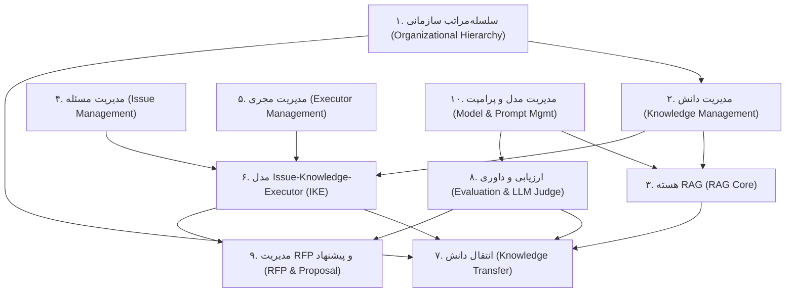

# گزارش کشف دامنه (Domain Discovery Report) — فاز ۱

**عنوان پروژه:** هسته RAG سلسله‌مراتبی آفلاین برای مدیریت دانش سازمانی، مدیریت مسئله و انتقال دانش مدیریتی  
**رویکرد معماری:** طراحی دامنه‌محور (Domain-Driven Design - DDD) و معماری تمیز (Clean Architecture)  
**محیط هدف:** ۱۰۰٪ آفلاین (مبتنی بر مدل‌های کوچک محلی `Embedding`، `LLM` و `LVM`)  
**قالب‌های اسنادی پشتیبانی‌شده:** `DOC`، `DOCX` و `PDF`  
**دامنه آزمون:** صرفاً آزمون واحد (Unit Testing) با استفاده از `Test Doubles`  
**وضعیت سند:** نسخه نهایی و مصوب فاز ۱ (`v0.1-phase1`)

---

## ۱. مقدمه و بیانیه مسئله
در سازمان‌های بزرگ، هلدینگ‌های فناوری و مراکز پژوهشی، دانش فنی و عملیاتی در لایه‌های اجرایی پایین‌دستی تولید و انباشته می‌شود، در حالی که لایه‌های مدیریتی و راهبردی بالادستی نیازمند دیدگاهی خلاصه‌شده، دقیق، امتیازدهی‌شده و متناسب با سطح تصمیم‌گیری خود هستند. از سوی دیگر، محدودیت‌های امنیتی و محرمانگی در بسیاری از سازمان‌ها مانع از ارسال اسناد، پروفایل‌های نیروی انسانی و گزارش‌های پروژه به سرویس‌های هوش مصنوعی ابری می‌شود.

این پروژه با هدف طراحی و پیاده‌سازی یک **هسته نرم‌افزاری ماژولار، دامنه‌محور و کاملاً آفلاین مبتنی بر Retrieval-Augmented Generation (RAG)** تعریف شده است. تمرکز پروژه بر ساخت یک بک‌اند و فرانت‌اند متعارف تجاری نیست؛ بلکه هدف، ایجاد یک هسته کتابخانه‌ای استاندارد و قابل آزمایش است که بتواند اسناد محلی را پردازش کند، سلسله‌مراتب ۵ لایه‌ای گره‌ها را مدل کند، رابطه سه‌وجهی میان **مسئله، دانش و مجری (`Issue-Knowledge-Executor`)** را برقرار سازد، خروجی‌ها را با سازوکار **LLM به‌عنوان داور** کنترل کیفیت نماید و در چرخه‌های آفلاین، آخرین بسته دانش قابل انتقال به لایه بالاتر را آماده و تحویل دهد.

---

## ۲. اهداف بیست‌گانه پروژه (منطبق بر بخش ۲ پروپوزال)

| ردیف | شرح هدف کلیدی پروژه | زمینه مرزبندی‌شده (Bounded Context) اصلی |
| :---: | :--- | :--- |
| **۱** | ایجاد معماری نرم‌افزاری مبتنی بر اصول طراحی دامنه‌محور (DDD) برای دانش سازمانی، مسئله، مجری و انتقال دانش. | تمامی Contextها (معماری هسته) |
| **۲** | توسعه هسته RAG آفلاین با استفاده از مدل‌های کوچک محلی `Embedding`، `LLM` و `LVM`. | هسته RAG / مدیریت مدل و پرامپت |
| **۳** | پشتیبانی از ورود و پردازش فایل‌های محلی با قالب‌های `DOC`، `DOCX` و `PDF`. | مدیریت دانش |
| **۴** | تعریف لایه‌های سازمانی (لایه ۰ تا ۴) و مشخص‌کردن شرکت‌ها، سازمان‌ها، زیرمجموعه‌ها و گره‌هایی که در هر لایه قرار می‌گیرند. | سلسله‌مراتب سازمانی |
| **۵** | فراهم‌کردن امکان تعریف نیاز دانشی هر لایه از زیرمجموعه‌های خود. | انتقال دانش / سلسله‌مراتب سازمانی |
| **۶** | استفاده از هوش مصنوعی برای بهبود، کاهش، افزایش، خلاصه‌سازی و پیشنهاد سطح مناسب جزئیات در انتقال دانش به لایه بالاتر. | انتقال دانش |
| **۷** | مدل‌سازی پروژه‌های تکمیل‌شده، پژوهش‌های انجام‌شده، دستاوردها، چالش‌ها، مسائل حل‌نشده و شکاف‌های پژوهشی. | مدیریت مسئله / مدیریت دانش |
| **۸** | فراهم‌کردن امکان نگهداری دانش بسیار جزئی در لایه‌های پایین‌تر و انتقال سطح مناسب‌تری از جزئیات به لایه‌های بالاتر. | انتقال دانش |
| **۹** | پشتیبانی از درخواست آفلاین لایه بالاتر برای دریافت آخرین نسخه آمادهشده اطلاعات از زیرمجموعه‌ها. | انتقال دانش |
| **۱۰** | پردازش چرخه‌ای دانش هر گره و ذخیره آخرین خروجی قابل انتقال در قالب `CSV` یا پایگاه داده محلی. | انتقال دانش |
| **۱۱** | ارائه قابلیت تجزیه مسئله، تولید زیرمسئله، مقایسه مسئله و مدل‌سازی رابطه `Issue-Knowledge-Executor`. | مدیریت مسئله / مدل `Issue-Knowledge-Executor` |
| **۱۲** | تولید پاسخ یا راه‌حل احتمالی برای مسائل بر اساس دانش موجود در گره. | هسته RAG / مدیریت مسئله |
| **۱۳** | تعیین وضعیت مسئله و درصد پیشرفت آن بر اساس قواعد قطعی و قابل آزمون. | مدیریت مسئله |
| **۱۴** | شناسایی و اولویت‌بندی مسائل کلیدی و شکاف‌های پژوهشی. | مدیریت مسئله |
| **۱۵** | تولید خودکار اسناد اعلام نیاز (`RFP`)، مدیریت پیشنهادهای دریافتی (`Proposal`)، ارزیابی آن‌ها و تولید بازخورد خودکار (`FeedbackReport`). | مدیریت RFP و پیشنهاد |
| **۱۶** | پشتیبانی از ثبت فراداده ساخت‌یافته (۱۸ فیلدی) همراه با تعریف مسئله و ثبت دانش. | مدیریت دانش / مدیریت مسئله |
| **۱۷** | تلقی معماری سامانه و مدل `Issue-Knowledge-Executor` به‌عنوان بخشی از دانش هر گره که قابل خلاصه‌سازی و انتقال به لایه بالاتر است. | مدل `Issue-Knowledge-Executor` / انتقال دانش |
| **۱۸** | پشتیبانی از دانش در هر حوزه موضوعی بدون اعمال محدودیت موضوعی بر محتوای اسناد. | مدیریت دانش |
| **۱۹** | امکان به‌روزرسانی، کنترل نسخه، خردسازی، مقایسه و تشخیص تکرار و هم‌پوشانی دانش. | مدیریت دانش |
| **۲۰** | تعریف شاخص‌های روشن و قابل اندازه‌گیری برای ارزیابی هر مؤلفه اصلی و بررسی آن‌ها با استاد راهنما یا تیم ارزیابی. | ارزیابی و داوری |

---

## ۳. تحلیل دامنه پروژه (موارد داخل دامنه و خارج از دامنه)

### ۳.۱ موارد داخل دامنه (In-Scope — بخش ۴.۱ پروپوزال)
1. **هسته RAG آفلاین:** قابل اجرا در محیط شبکه‌ای ایزوله و کاملاً آفلاین بدون وابستگی به اینترنت.
2. **خط لوله ورود اسناد محلی:** پردازش قالب‌های `DOC`، `DOCX` و `PDF` همراه با استخراج متن، ساختار و ارجاع صفحه/بخش.
3. **مدل‌های کوچک آفلاین:** بهره‌گیری از مدل‌های محلی `Embedding` (برای نمایش برداری و بازیابی معنایی)، `LLM` (برای خلاصه‌سازی، پاسخ‌گویی، تحلیل مسئله، تولید RFP و بازخورد) و `LVM` (در مواردی که تفسیر بصری، تصویری یا چیدمان پیچیده سند لازم باشد).
4. **مدل‌سازی سلسله‌مراتب سازمانی:** تعریف گره سازمانی (`Node`)، ثبت لایه‌ها (`Layer` از ۰ تا ۴)، روابط والد-فرزند و مدیریت مرز گره نهایی (`is_leaf_boundary`).
5. **مدیریت چرخه عمر دانش:** ثبت اولیه، فراداده ۱۸ فیلدی، خردسازی، نسخه‌بندی بدون حذف سوابق، و تشخیص تکرار و هم‌پوشانی.
6. **مدیریت مسئله و مجری:** مدل‌سازی مسئله (`Issue`)، تجزیه به زیرمسئله (`SubIssue`)، پروفایل مجری (`Executor`) و مثلث `Issue-Knowledge-Executor`.
7. **پردازش چرخه‌ای و انتقال آفلاین:** آماده‌سازی بسته‌های انتقال دانش (`TransferPackage`) برای لایه بالاتر و ذخیره‌سازی در قالب `CSV` و پایگاه داده محلی.
8. **سازوکار LLM به‌عنوان داور:** ارزیابی خروجی‌ها بر اساس چارچوب ۲۰ نمره‌ای (`JudgeRubric`) و اعمال حد آستانه (`JudgeThreshold` با پیش‌فرض ۱۸ از ۲۰).
9. **آزمون واحد (Unit Testing):** پوشش کامل منطق دامنه، سرویس‌های کاربردی، قواعد امتیازدهی، قواعد خردسازی، ساخت روابط و مونتاژ پرامپت.
10. **مستندات فنی و شاخص‌های ارزیابی:** ارائه گزارش‌های رسمی، واژه‌نامه DDD و ماتریس‌های ارزیابی.

### ۳.۲ موارد خارج از دامنه (Out-of-Scope — بخش ۴.۲ پروپوزال)
1. **عدم توسعه بک‌اند مجزا** به‌عنوان محصول سرور مستقل تجاری.
2. **عدم توسعه فرانت‌اند یا رابط کاربری گرافیکی مجزا** به‌عنوان محصول مستقل.
3. **عدم میزبانی مدل‌ها در فضای ابری** و عدم استفاده از APIهای تجاری آنلاین.
4. **عدم پردازش وابسته به اینترنت** در هیچ‌یک از گردش‌کارهای اصلی.
5. **عدم یکپارچه‌سازی پیچیده با سامانه‌های هویت سازمانی** (مانند SSO/LDAP سازمانی).
6. **عدم اجرای آزمون‌های خارج از سطح واحد:** آزمون انتهابه‌انتها (E2E)، آزمون یکپارچه‌سازی سنگین، آزمون مرورگر، آزمون بار (Load Test)، آزمون نفوذ امنیتی و ارزیابی کاربری خودکار در دامنه این پروژه قرار ندارند.
7. **عدم همگام‌سازی لحظه‌ای (Real-time Sync) بین گره‌ها:** تبادل دانش به صورت چرخه‌ای و آفلاین انجام می‌شود.
8. **عدم آموزش مدل‌های بنیادین بزرگ از ابتدا (Pre-training from scratch).**

---

## ۴. فرضیات بنیادین پروژه (بخش ۴.۳ پروپوزال)
- در فازهای آغازین، مجموعه‌ای از اسناد، تعریف گره‌ها، اطلاعات لایه‌های سازمانی و مسائل نمونه در قالب یک مطالعه موردی استاندارد آماده می‌شود.
- تمامی مدل‌های هوش مصنوعی به صورت محلی و در محیط آفلاین اجرا می‌شوند و در سطح آزمون واحد از طریق `Adapter`های قطعی و `Test Double` بررسی می‌گردند.
- خروجی اصلی پروژه یک **هسته نرم‌افزاری (Core Library)** است که در آینده می‌تواند بدون تغییر بنیادین در مدل دامنه، به رابط‌های کاربری یا موتورهای گردش کار عملیاتی متصل شود.
- زیرساختار داخلی یک گره فقط در صورتی مدل می‌شود که در سناریوی مطالعه موردی به آن نیاز باشد؛ در غیر این صورت گره با ویژگی `is_leaf_boundary=True` به عنوان مرز نهایی علامت‌گذاری می‌شود.

---

## ۵. زمینه‌های مرزبندی‌شده (Bounded Contexts) در معماری DDD

طبق بخش ۵.۱ پروپوزال، دامنه مسئله به **۱۰ زمینه مرزبندی‌شده (Bounded Contexts)** تفکیک شده است تا از پیچیدگی کنترل‌نشده جلوگیری شود:

| شماره | نام Context (فارسی و انگلیسی) | هدف و مسئولیت اصلی در دامنه | موجودیت‌ها و اشیاء مقداری کلیدی |
| :---: | :--- | :--- | :--- |
| **۱** | **سلسله‌مراتب سازمانی** (`Organizational Hierarchy`) | تعریف گره‌ها، لایه‌ها (۰ تا ۴)، شرکت‌ها، سازمان‌ها، زیرمجموعه‌ها، حوزه‌های فعالیت، روابط بالادستی و مرز گره نهایی (`LayerNodeRegistry`). | `Node`, `Layer`, `NodeIdentifier`, `LayerIndex` |
| **۲** | **مدیریت دانش** (`Knowledge Management`) | مدیریت اقلام دانش، ورود اسناد (`DOC/DOCX/PDF`)، قطعات دانش، فراداده ۱۸ فیلدی، نسخه‌ها، ارجاع به منبع، تشخیص موارد تکراری و هم‌پوشانی‌ها. | `KnowledgeItem`, `KnowledgeVersion`, `KnowledgeChunk`, `KnowledgeScope`, `VersionTag`, `MetadataRecord` |
| **۳** | **هسته RAG** (`RAG Core`) | مدیریت `Embedding`، بازیابی مقید به گره، رتبه‌بندی، آماده‌سازی بسته زمینه (Context Assembly)، تولید خروجی و پاسخ مبتنی بر منبع همراه با اعلام عدم قطعیت. | `RetrievalQuery`, `SimilarityScore`, `KnowledgeChunk` |
| **۴** | **مدیریت مسئله** (`Issue Management`) | مدیریت مسئله، تجزیه به زیرمسئله، جایگاه نسبی، محاسبه درصد پیشرفت، وضعیت، اولویت‌بندی مسائل کلیدی و شناسایی شکاف پژوهشی. | `Issue`, `SubIssue`, `ProgressPercentage`, `MetadataRecord` |
| **۵** | **مدیریت مجری** (`Executor Management`) | مدیریت پروفایل نیروها، مجریان، حوزه‌های تخصص، توانمندی‌ها، سوابق پروژه‌ها و پیشنهاد تخصیص مجری به مسئله. | `Executor`, `NodeIdentifier` |
| **۶** | **مدل Issue-Knowledge-Executor** (`IKE Model`) | ایجاد، نگهداری و خلاصه‌سازی گراف روابط میان مسئله، شواهد دانشی موجود و توانمندی مجریان، و ارائه خودِ مدل به‌عنوان دانش قابل انتقال گره. | `Issue`, `KnowledgeItem`, `Executor`, `SimilarityScore` |
| **۷** | **انتقال دانش** (`Knowledge Transfer`) | آماده‌سازی بسته‌های انتقال چرخه‌ای، اعمال قواعد لایه، تنظیم ۴ سطح جزئیات (`TransferDetailLevel`) و ذخیره آخرین نسخه‌های پذیرفته‌شده در `CSV` و پایگاه داده. | `TransferPackage`, `TransferDetailLevel`, `VersionTag`, `LayerIndex` |
| **۸** | **ارزیابی و داوری** (`Evaluation & Judge`) | امتیازدهی به خروجی‌ها و بسته‌های انتقال بر اساس دانش منبع، درخواست کاربر و چارچوب ۲۰ نمره‌ای داور (`JudgeRubric`) و کنترل حد آستانه (`JudgeThreshold`). | `JudgeScore`, `JudgeRubric`, `JudgeThreshold` |
| **۹** | **مدیریت RFP و پیشنهاد** (`RFP & Proposal Management`) | تولید خودکار سند اعلام نیاز (`RFP`) از مسائل و شکاف‌های پژوهشی، ثبت و ارزیابی پیشنهادهای دریافتی (`Proposal`) و تولید گزارش بازخورد (`FeedbackReport`). | `RFP`, `Proposal`, `FeedbackReport` |
| **۱۰** | **مدیریت مدل و پرامپت** (`Model & Prompt Management`) | مدیریت رجیستری مدل‌های کوچک محلی (`Embedding`, `LLM`, `LVM`)، نسخه‌بندی قالب‌های پرامپت در ۱۱ دسته وظیفه، قواعد مونتاژ و سوابق ارزیابی مدل. | `JudgeRubric`, `RetrievalQuery` |

---

## ۶. تشریح مطالعه موردی ۵ لایه‌ای (Case Study)

در فاز ۱، یک مطالعه موردی جامع ۵ لایه‌ای برای **«هلدینگ فناوری و هوش مصنوعی پیشرو»** طراحی و در اسکریپت [`generate_phase1_case_study.py`](file:///d:/offline-hierarchical-rag-core/scripts/generate_phase1_case_study.py) و فایل [`case_study_registry.json`](file:///d:/offline-hierarchical-rag-core/sample_docs/case_study_registry.json) پیاده‌سازی شده است:

| لایه | عنوان لایه | گره‌های تعریف‌شده در مطالعه موردی | والد گره | وضعیت مرز نهایی (`is_leaf_boundary`) | سطح جزئیات انتقال به بالا |
| :---: | :--- | :--- | :---: | :---: | :---: |
| **۰** | لایه راهبردی | `L0-STRATEGIC-BOARD` (شورای عالی راهبردی و هیئت‌مدیره هلدینگ) | ندارد (`None`) | `False` | `EXECUTIVE_HIGH` |
| **۱** | سازمان‌های مادر | `L1-AI-MOTHER-ORG` (سازمان مادر هوش مصنوعی و سامانه‌های دانش‌بنیان) | `L0-STRATEGIC-BOARD` | `False` | `EXECUTIVE_HIGH` |
| **۱** | سازمان‌های مادر | `L1-INFRA-MOTHER-ORG` (سازمان مادر زیرساخت، امنیت و شبکه ایزوله) | `L0-STRATEGIC-BOARD` | `False` | `EXECUTIVE_HIGH` |
| **۱** | سازمان‌های مادر | `L1-EXTERNAL-AUDIT-ORG` (مؤسسه مستقل ممیزی برون‌سازمانی) | `L0-STRATEGIC-BOARD` | `True` (مرز نهایی) | `EXECUTIVE_HIGH` |
| **۲** | زیرمجموعه‌ها و واحدهای تخصصی | `L2-NLP-RESEARCH-CENTER` (مرکز پژوهشی پردازش زبان طبیعی و SLM) | `L1-AI-MOTHER-ORG` | `False` | `MANAGERIAL` |
| **۲** | زیرمجموعه‌ها و واحدهای تخصصی | `L2-DOC-VISION-UNIT` (واحد مهندسی پردازش اسناد و مدل‌های LVM) | `L1-AI-MOTHER-ORG` | `False` | `MANAGERIAL` |
| **۲** | زیرمجموعه‌ها و واحدهای تخصصی | `L2-OFFLINE-SEC-UNIT` (واحد عملیات ذخیره‌سازی محلی و قیود آفلاین) | `L1-INFRA-MOTHER-ORG` | `True` (مرز نهایی) | `MANAGERIAL` |
| **۳** | پروژه‌ها، تیم‌ها و گره‌های اجرایی | `L3-RAG-CORE-TEAM` (تیم اجرایی توسعه هسته RAG سلسله‌مراتبی) | `L2-NLP-RESEARCH-CENTER` | `False` | `TECHNICAL_SUMMARY` |
| **۳** | پروژه‌ها، تیم‌ها و گره‌های اجرایی | `L3-JUDGE-CALIBRATION-TEAM` (گروه اجرایی کالیبراسیون داور LLM) | `L2-NLP-RESEARCH-CENTER` | `True` (مرز نهایی) | `TECHNICAL_SUMMARY` |
| **۳** | پروژه‌ها، تیم‌ها و گره‌های اجرایی | `L3-INGESTION-PIPELINE-TEAM` (تیم پیاده‌سازی مبدل‌های اسناد و LVM) | `L2-DOC-VISION-UNIT` | `True` (مرز نهایی) | `TECHNICAL_SUMMARY` |
| **۴** | منابع داخلی دانش اختیاری | `L4-ARCH-DOCS-ARCHIVE` (مخزن محلی اسناد معماری و مستندات فنی) | `L3-RAG-CORE-TEAM` | `True` (مرز نهایی) | `TECHNICAL_DETAILED` |
| **۴** | منابع داخلی دانش اختیاری | `L4-PERSONNEL-PROFILES-REPO` (آرشیو سوابق پرسنلی و پروفایل مجریان) | `L3-RAG-CORE-TEAM` | `True` (مرز نهایی) | `TECHNICAL_DETAILED` |

---

## ۷. استراتژی آزمون واحد (Unit Testing Strategy) و Test Doubles

بر اساس بخش ۱۸ پروپوزال، ارزیابی نرم‌افزار در این پروژه به صورت متمرکز بر **آزمون واحد (Unit Testing)** بنا نهاده شده است:
1. **استقلال کامل لایه دامنه:** تمامی کلاس‌های موجود در `src/domain/` هیچ وابستگی به شبکه، فایل‌سیستم خارجی یا موتورهای اجرای مدل ندارند و ناوردایی‌های کسب‌وکار را به صورت ۱۰۰٪ قطعی (Deterministic) در حافظه بررسی می‌کنند.
2. **استفاده از `Test Doubles` (شامل `Stub`, `Mock`, `Fake`):** در فازهای آتی که سرویس‌های کاربردی نیازمند تعامل با پایگاه داده، نمایه برداری یا مدل‌های محلی (`Embedding`, `LLM`, `LVM`) هستند، از طریق الگوهای `Repository` و `Adapter`های قطعی با پاسخ‌های نمونه ثابت آزمایش می‌شوند تا اجرای تست‌ها در کسری از ثانیه و بدون نیاز به بارگذاری وزن‌های سنگین مدل در محیط تست انجام پذیرد.
3. **پوشش ۱۷ حوزه آزمون واحد (بخش ۱۸.۱ پروپوزال):** شامل قواعد ایجاد گره و لایه، اعتبارسنجی رابطه والد و فرزند، مرز گره نهایی، فراداده ۱۸ فیلدی، نسخه‌بندی دانش، خردسازی، تشخیص تکرار/هم‌پوشانی، ایجاد مسئله و زیرمسئله، محاسبه درصد پیشرفت، اولویت‌بندی، تطبیق مجری، مونتاژ بسته انتقال، اعمال حد آستانه امتیاز داور، مونتاژ پرامپت، ساختار RFP، ارزیابی پیشنهاد و قالب‌بندی خروجی `CSV`.
