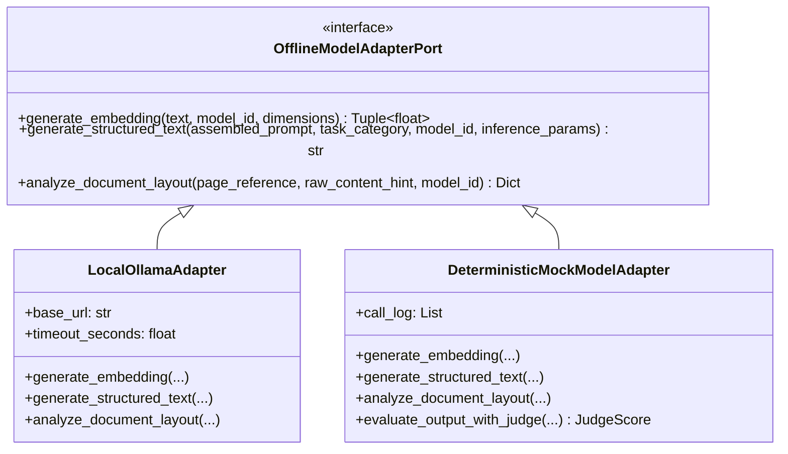

# روش استفاده از مدل‌های آفلاین (Model Usage Procedure) — فاز ۲

**ماژول‌های مرجع:**  
- درگاه و آداپتورها: [`src/infrastructure/offline_model_adapter.py`](file:///d:/offline-hierarchical-rag-core/src/infrastructure/offline_model_adapter.py)  
- رجیستری مدل‌ها: [`src/domain/model_registry.py`](file:///d:/offline-hierarchical-rag-core/src/domain/model_registry.py)

---

## ۱. معماری Ports & Adapters برای جداسازی منطق دامنه از اجرای مدل
در راستای رعایت اصول **Clean Architecture** و بخش ۱۸.۲ پروپوزال، لایه دامنه (`src/domain/`) هیچ وابستگی مستقیمی به موتور اجرای مدل ندارد. در عوض، درگاه انتزاعی [`OfflineModelAdapterPort`](file:///d:/offline-hierarchical-rag-core/src/infrastructure/offline_model_adapter.py#L40-L67) سه عملیات پایه را تعریف می‌کند:
1. `generate_embedding(text, model_id, dimensions)`: تولید بردار تعبیه نرمال‌شده برای نمایه‌سازی معنایی و تشخیص تکرار/هم‌پوشانی.
2. `generate_structured_text(assembled_prompt, task_category, model_id, inference_params)`: تولید خروجی متنی ساختاریافته (`JSON`) برای ۱۲ دسته پرامپت سامانه.
3. `analyze_document_layout(page_reference, raw_content_hint, model_id)`: تحلیل بصری جداول پیچیده و چیدمان صفحات اسناد توسط مدل بینایی-زبانی (`LVM`).



---

## ۲. راهنمای استقرار و اجرای ۱۰۰٪ آفلاین با Ollama و فایل‌های `GGUF`

### ۲.۱ واردسازی آفلاین وزن‌های `GGUF` در محیط ایزوله (Air-Gapped)
در محیط شبکه‌ای آفلاین که دسترسی به اینترنت وجود ندارد، فایل‌های وزن کوانتیزه‌شده (`.gguf`) از مخزن فیزیکی داخلی سازمان بارگذاری شده و با استفاده از یک `Modelfile` محلی در سرویس `Ollama` ثبت می‌شوند:

```dockerfile
# نمونه Modelfile برای ثبت آفلاین مدل Qwen 2.5 3B Instruct (Q4_K_M)
FROM ./local_weights/qwen2.5-3b-instruct-q4_k_m.gguf
PARAMETER temperature 0.1
PARAMETER top_p 0.9
PARAMETER num_ctx 8192
```

دستورات ثبت مدل در ترمینال محلی (بدون اینترنت):
```powershell
ollama create qwen2.5:3b-instruct-q4_K_M -f ./Modelfile.qwen25
ollama create bge-m3 -f ./Modelfile.bgem3
ollama create qwen2.5-vl:3b -f ./Modelfile.qwen25vl
```

### ۲.۲ کنترل سخت‌گیرانه قید شبکه محلی (Loopback Enforcement)
کلاس [`LocalOllamaAdapter`](file:///d:/offline-hierarchical-rag-core/src/infrastructure/offline_model_adapter.py#L70-L214) با استفاده از کتابخانه استاندارد `urllib.request` پایتون (بدون نیاز به نصب پکیج‌های اینترنتی ثالث) به آدرس محلی `http://localhost:11434` متصل می‌شود.  
در سازنده این کلاس، میزبان آدرس (`hostname`) اعتبارسنجی شده و **صرفاً مقادیر `localhost`، `127.0.0.1` و `::1` مجاز هستند**. در صورت ارسال هرگونه آدرس اینترنتی یا ابری، استثنای [`OfflineAdapterError`](file:///d:/offline-hierarchical-rag-core/src/domain/exceptions.py#L131-L136) بلافاصله پرتاب می‌شود تا قید امنیتی بخش ۲۰ پروپوزال تضمین گردد.

---

## ۳. استاندارد تنظیم پارامترهای استنتاج (`Inference Parameters`)

برای دستیابی به خروجی‌های پایدار، قابل اتکا و بدون توهم در مدل‌های کوچک محلی، پارامترهای زیر در [`OfflineModelSpecification`](file:///d:/offline-hierarchical-rag-core/src/domain/model_registry.py#L85-L216) استانداردسازی شده‌اند:

| دسته مدل / وظیفه | `temperature` | `top_p` | `max_tokens` | علت انتخاب فنی |
| :--- | :---: | :---: | :---: | :--- |
| **نمایه‌سازی برداری (`bge-m3`)** | `0.0` | `1.0` | `512` | تولید بردار کاملاً قطعی و یکسان برای متون مشابه در تشخیص تکرار. |
| **داوری خروجی (`LLM-as-a-Judge`)** | `0.1` | `0.9` | `1536` | جلوگیری از نوسان امتیازات ۷ معیار جدول ۱۶.۱ و تضمین تکرارپذیری داوری. |
| **خلاصه‌سازی، تجزیه مسئله و تولید RFP** | `0.1` | `0.9` | `1536` | حفظ وفاداری حداکثری به اسناد منبع (`source_fidelity`) و رعایت دقیق قالب JSON. |
| **تحلیل بصری جدول و چیدمان (`qwen2.5-vl:3b`)** | `0.05` | `0.85` | `1024` | استخراج دقیق ارقام و سرستون‌های جدول بدون تغییر خلاقانه در مقادیر سلول‌ها. |

---

## ۴. نحوه کار با آداپتور قطعی (`DeterministicMockModelAdapter`) در آزمون‌های واحد

طبق تصریح بخش ۱۸.۲ پروپوزال (صفحه ۳۲):
> *«رفتارهایی که نیازمند اجرای واقعی مدل هستند می‌توانند از طریق Adapterهای قطعی، خروجی‌های Mock یا پاسخ‌های نمونه ثابت مدل محلی در سطح آزمون واحد بررسی شوند.»*

کلاس [`DeterministicMockModelAdapter`](file:///d:/offline-hierarchical-rag-core/src/infrastructure/offline_model_adapter.py#L217-L561) این نیازمندی را به صورت کامل برآورده می‌سازد:
1. **تولید بردارهای نرمال‌شده قطعی:** از هش `SHA-256` متن نرمال‌شده برای تولید بردارهای با نرم اقلیدسی واحد (`L2 Norm = 1.0`) استفاده می‌کند؛ بنابراین شباهت کسینوسی دو متن یکسان همواره `1.0` است.
2. **پوشش کامل هر ۱۲ دسته پرامپت:** برای هر ۱۲ مقدار [`PromptTaskCategory`](file:///d:/offline-hierarchical-rag-core/src/domain/prompt_registry.py#L31-L82)، خروجی JSON معتبر شامل تمامی کلیدهای `expected_json_keys` و ارجاعات منبع `[KI-001]` تولید می‌کند.
3. **پشتیبانی از آزمون کمبود دانش و رد شدن در داوری:**
   - در صورت وجود نشانه `INSUFFICIENT_CONTEXT` در پرامپت، مقدار `"uncertainty_status": "INSUFFICIENT_KNOWLEDGE"` را بازمی‌گرداند.
   - در صورت وجود نشانه `LOW_QUALITY_OUTPUT` در ورودی داور، امتیاز `14` از `20` تولید می‌کند تا رفتار سامانه در برابر خطای [`JudgeThresholdNotMetError`](file:///d:/offline-hierarchical-rag-core/src/domain/exceptions.py#L79-L94) در آزمون واحد به دقت سنجیده شود.
